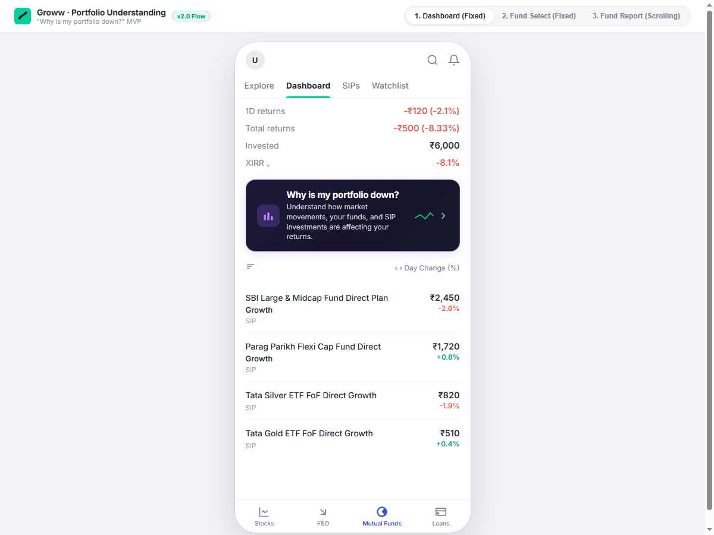
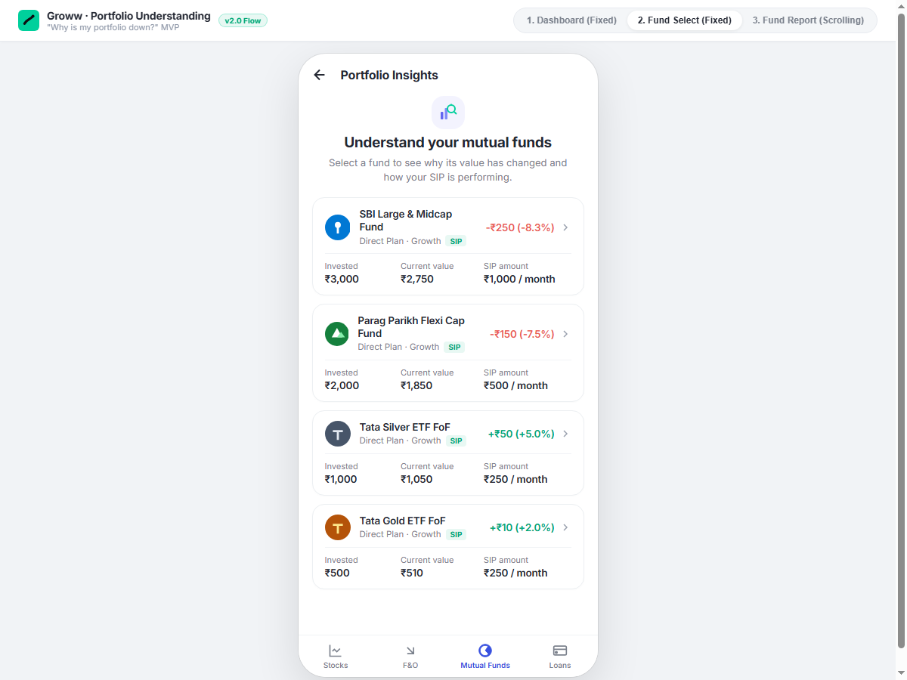
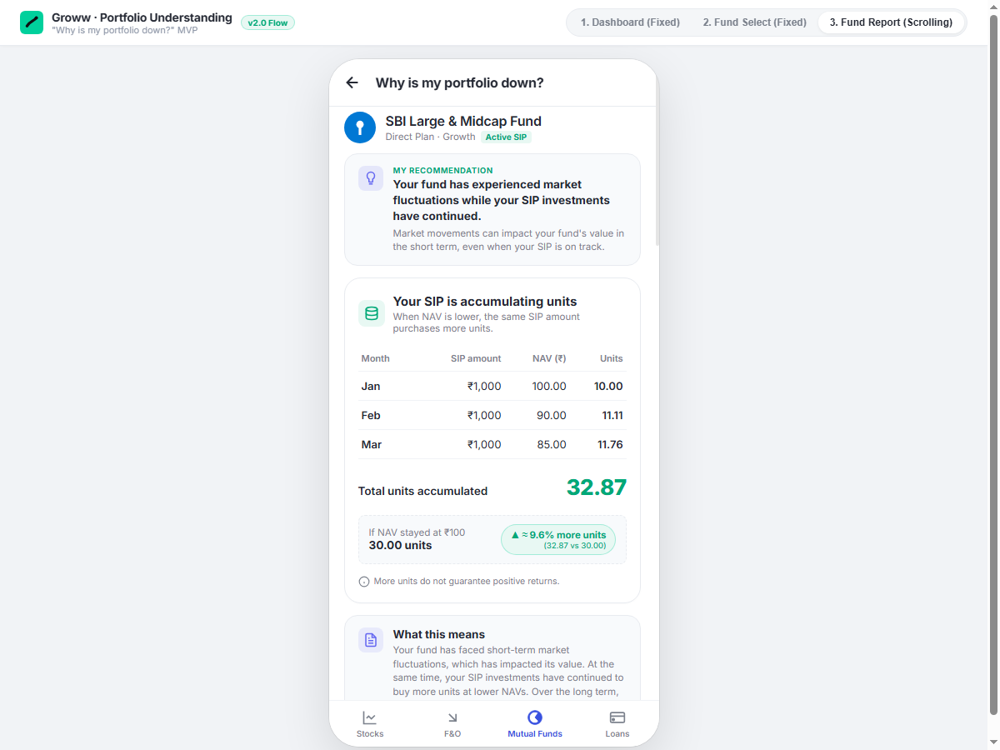

# Groww Mutual Funds – Portfolio Understanding MVP
### *"Why is my portfolio down?"*

[](https://saurabhsawarkarr.github.io/groww_mvp)
[](index.html)
[-success?style=for-the-badge)](#)
[](#)

An authentic, mobile-first interactive prototype built for **Groww Mutual Funds** addressing investor panic during short-term market drawdowns. The solution educates first-time SIP investors on **Rupee-Cost Averaging**, macroeconomic attribution, and fund manager continuity—converting anxious exits into disciplined long-term investing.

---

## 📱 Prototype Visual Walkthrough

| 1. Dashboard (Fixed Viewport) | 2. Fund Select (Spacious & Fixed) | 3. Fund Deep Dive (Continuous Scroll) |
| :---: | :---: | :---: |
|  |  |  |

---

## 🎯 The Core Problem & Solution

### The Problem
First-time mutual fund investors checking their portfolio during market dips frequently see negative returns (e.g. `-8.33%`). Without financial market context:
* They misunderstand unrealized short-term dips as permanent capital loss.
* They pause or cancel active SIPs precisely when unit accumulation is cheapest.
* They panic-sell and miss the subsequent market recovery.

### The Solution: A Guided 3-Step Experience
1. **Screen 1 – Fixed Dashboard:** Features a prominent, reassuring banner: *"Why is my portfolio down? Understand how market movements, your funds, and SIP investments are affecting your returns."*
2. **Screen 2 – Fund Selection (Non-scrolling, Airy):** Displays each holding with its 3-column stats (`Invested`, `Current value`, `SIP amount / month`) and clear return badges (`-₹250 (-8.3%)`), allowing the user to select the specific fund they want to investigate.
3. **Screen 3+ – Unified Continuous Scrolling Report:** Combines all analysis modules into a single, comprehensive vertical feed:
   * **SIP Unit Accumulation:** Illustrates Rupee-Cost Averaging through transaction tables showing how lower NAVs purchase more units (`32.87 units` vs `30.00 units` at baseline).
   * **Market Impact & Attribution (Proprietary Moat):** Separates public macroeconomic factors (Nifty 50 `-2.6%`, Sector `-4.1%`, Stock selection `-2.0%`) from Groww's proprietary transaction ledger metric: **`Your personal entry timing (+0.4%)`**, demonstrating how SIP purchase discipline generated positive alpha even during a drawdown.
   * **Historical Drawdown Recovery Curve:** Shows past recovery trajectories (e.g. `-12.4%` in Mar–May 2020 followed by `+31.2%` rebound over the next 12 months).
   * **Fund Manager & Performance (Transparent Disclosure):** Features a 4-card governance breakdown: manager profile (Mr. R. Srinivasan with `5+ years` badge), 3-year performance comparison (`12.4%` fund vs `10.1%` category average with dual trendline chart), explicit **Investment Approach** strategy card, and the mandatory **"Keep in mind"** regulatory disclaimer (*"Past performance shows how the fund has behaved, but it does not guarantee future returns"*).
   * **Fund Governance & Cohort Intelligence (Network Moat):** Features an objective factsheet summary with neutral factual indicators (management tenure, expense ratio, rebalancing discipline) and the proprietary 5th takeaway: `81% of Groww SIP investors in this fund continued investing through the last market dip`, backed by the **"What other Groww investors in this fund did"** peer activity breakdown card (81% Continued, 12% Paused, 7% Stopped across 1,24,000 investors). Bottom buttons provide clean dual choices: `Change Fund` (mint) and `Back to portfolio` (emerald green).

---

## 🎨 Authentic Groww Design System

Built to mirror Groww's real production mobile application:
* **Palette:** Crisp Groww White (`#FFFFFF`), Charcoal text (`#242833`), Muted Gray (`#7C828D`), Groww Green (`#00D09C`), Mint background (`#E8F8F3`), and Drawdown Red (`#EB5B56`).
* **Borderless Tables:** Replaced artificial gridlines with generous whitespace, hairline dividers (`#F1F3F6`), and vertical column alignment.
* **Groww Navigation Chrome:** Top tabs (`Explore`, `Dashboard`, `SIPs`, `Watchlist`) and bottom navigation (`Stocks`, `F&O`, `Mutual Funds` [crescent moon icon], `Loans`).
* **Mobile Frame Simulator:** Realistic 396px phone simulator with dynamic internal scrolling states and interactive step toggles for stakeholder presentations.

---

## 📂 Project Structure

```text
Groww MVP/
├── .github/
│   └── workflows/
│       └── deploy.yml           # Automated GitHub Pages CI/CD workflow
├── css/
│   └── groww.css                # Groww Light Theme tokens, layout & responsive styles
├── js/
│   ├── app.js                   # State machine, navigation controller & dynamic renderer
│   └── data.js                  # Mutual funds dataset, portfolio metrics & historical data
├── docs/
│   └── screenshots/             # Production preview screenshots for documentation
│       ├── dashboard.png
│       ├── fund-selection.png
│       ├── fund-report.png
│       └── fund-health-actions.png
├── index.html                   # Mobile simulator frame, presentation header & entry point
├── architecture.md              # Technical specifications, state flow & component schema
├── context.md                   # Product requirements document & SEBI compliance guidelines
├── .gitignore                   # Clean ignore configuration for Git/GitHub
└── README.md                    # Repository documentation
```

---

## 🚀 Quick Start (Running Locally)

This prototype is zero-dependency vanilla web code. You can run it with any local static server:

### Option 1: Python (Built-in)
```bash
# In the project directory:
python -m http.server 8080
```
Open **[http://localhost:8080](http://localhost:8080)** in your browser.

### Option 2: Node.js (npx)
```bash
npx serve .
```

### Option 3: VS Code Live Server
Right-click `index.html` and select **"Open with Live Server"**.

---

## 🌐 Deploying to GitHub Pages

1. Push this repository to GitHub:
   ```bash
   git remote add origin https://github.com/saurabhsawarkarr/groww_mvp.git
   git branch -M main
   git push -u origin main
   ```
2. In your GitHub repository settings:
   * Go to **Settings** &rarr; **Pages**.
   * Under **Build and deployment** &rarr; **Source**, select **Deploy from a branch**.
   * Select branch **`main`** and folder **`/ (root)`**, then click **Save**.
3. GitHub Pages will build and publish your live prototype at `https://saurabhsawarkarr.github.io/groww_mvp/`!

---

## ⚖️ Compliance & Disclaimers
* Mutual fund investments are subject to market risks. Read all scheme related documents carefully.
* All figures, returns, and fund manager continuity indicators shown in this prototype are illustrative simulations designed to educate users on Rupee-Cost Averaging and portfolio diversification principles.
