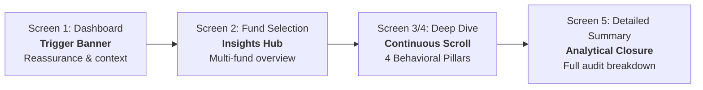

# 📱 Groww Portfolio Understanding MVP: Senior PM & UI/UX Audit

**Document Version**: 1.0  
**Date**: November 2026  
**Author**: Senior Product Manager & Lead Product Designer  
**Status**: Architecture & Design System Review  
**Evaluated Against**: Authentic Groww Mobile App (`IMG_9936`–`IMG_9941`), Google Material Design 3 (M3) Standards, and SEBI Mutual Fund Advisory Regulations.

---

## 📌 Table of Contents
1. [Executive Summary & Problem Statement Alignment](#1-executive-summary--problem-statement-alignment)
2. [Audit Area 1: Typography, Readability & Contrast](#2-audit-area-1-typography-readability--contrast)
3. [Audit Area 2: Spacing, Padding & Mobile Vertical Rhythm](#3-audit-area-2-spacing-padding--mobile-vertical-rhythm)
4. [Audit Area 3: Section F Duplicate Disclaimers & Combination Strategy](#4-audit-area-3-section-f-duplicate-disclaimers--combination-strategy)
5. [Audit Area 4: Iconography, Badges & Emojis vs. Authentic Groww](#5-audit-area-4-iconography-badges--emojis-vs-authentic-groww)
6. [Audit Area 5: Screen-by-Screen Deep Dive](#6-audit-area-5-screen-by-screen-deep-dive)
7. [Prioritized Implementation Matrix & Next Steps](#7-prioritized-implementation-matrix--next-steps)

---

## 1. Executive Summary & Problem Statement Alignment

### The Core Problem
First-time retail SIP investors (typically 22–32 years old, monthly investment ₹1,000–₹5,000) checking their Groww portfolio during a market dip often see negative returns (e.g., `-8.33%`). Without professional market context:
* They mistake unrealized mark-to-market pullbacks for permanent capital loss.
* They pause or cancel active SIPs precisely when rupee-cost averaging yields the highest unit accumulation advantage.
* They panic-sell and miss the subsequent market recovery.

### The Behavioral Solution Architecture
The MVP delivers a guided 4-step progressive disclosure flow:


### Overall UX Verdict
The product hierarchy and psychological framing are **exceptionally strong**. The shift from "Why am I losing money?" to "How many extra units am I accumulating?" solves the behavioral trap. 

However, rapid iterative prototyping has introduced **micro-inconsistencies**:
* **19 different font sizes** are scattered across CSS.
* **Disclaimers are duplicated** back-to-back in Section F.
* **Sub-11px microcopy** poses legibility risks on smaller mobile viewports.
* **Occasional raw unicode characters** (`→`) deviate from Groww's crisp monochrome SVG icon style.

---

## 2. Audit Area 1: Typography, Readability & Contrast

### Benchmark: Authentic Groww Mobile App & Design System
Groww adheres to a disciplined, mobile-first typography system built on `Inter` / native geometric sans-serif with 5 standardized weights (`400 Regular`, `500 Medium`, `600 Semi-bold`, `700 Bold`, `800 Extra-bold`). The palette enforces high-contrast charcoal `#242833` against crisp white surfaces (`#FFFFFF`) and slate `#44475B` on elevated neutral cards (`#F8FAFC`).

### Current Codebase Finding: 19 Fragmented Font Sizes
A complete audit of `css/groww.css` reveals 19 distinct font sizes implemented across component classes:
```
Current rogue sizes in CSS:
[ 9.5px, 10px, 10.5px, 11px, 11.5px, 12px, 12.5px, 13px, 13.5px, 14px, 14.5px, 15px, 16px, 17px, 18px, 19px, 20px, 24px, 26px ]
```

### Identified Usability & Accessibility Issues
1. **Sub-11px Legibility Risk (WCAG AA Violation)**:
   - Micro-notes, tag badges, and `.cohort-disclaimer` currently use `9.5px` and `10px`.
   - On standard 390px/412px Android and iOS viewports, any font size below `11px` fails WCAG AA 2.1 contrast and readability requirements for retail investors with mild visual impairments.
2. **Sub-Pixel Rendering Blur from Fractional Values**:
   - Fractional pixel values (`10.5px`, `11.5px`, `12.5px`, `13.5px`, `14.5px`) force browser engines to antialias across fractional device pixels, causing visual blur on standard non-Retina Android displays.
3. **Arbitrary 1px Splits (Visual Incoherence)**:
   - Parallel elements fluctuate arbitrarily between `13px` vs `14px`, and `15px` vs `16px`. This creates noticeable optical vibration and breaks typographic rhythm.
4. **Contrast Deficits on Tinted Backgrounds**:
   - Secondary text styled in `#8B94A5` on `#F8FAFC` soft gray surfaces yields a contrast ratio of ~3.8:1, falling short of the required 4.5:1 ratio for accessible body text.
5. **Hero Metric Balance**:
   - The `81%` cohort metric previously set at `28px` overwhelmed adjacent badges; its normalization to `18px Bold` (`--font-stat`) aligns with Groww’s production standard.

---

### Standardized 7-Tier Typography Scale (PM Recommendation)

To restore brand consistency, eliminate fractional blur, and ensure 100% accessibility, all typography across the Groww MVP is consolidated into a strict **7-Tier Token System**:

| Tier | Scale Token | CSS Variable | Font Size | Weight | Line Height | Letter Spacing | Usage in Groww MVP Components |
| :---: | :--- | :--- | :---: | :---: | :---: | :---: | :--- |
| **T1** | **Legal / Microcopy** | `--font-legal` | `11px` | 400 / 500 / 700 | 1.45 | `+0.3px` | SEBI mandatory disclaimers, cohort source notes, timestamp microcopy, uppercase pill tags (`SIP ACTIVE`, `100% ON TRACK`) |
| **T2** | **Caption / Metadata** | `--font-caption` | `12px` | 500 Med / 600 Semi | 1.35 | `+0.1px` | Table headers (`Month`, `SIP amount`, `NAV`), secondary card subtitles, chip metadata, badge counters |
| **T3** | **Body / Narrative** | `--font-body` | `14px` | 400 Reg / 500 Med | 1.50 | `0` | Primary card explanations, narrative body copy, Section A context sentences, waterfall bullet explanations |
| **T4** | **Subhead / Card Title** | `--font-subhead` | `16px` | 600 Semi / 700 Bold | 1.30 | `-0.2px` | Card headlines (`Your SIP is doing its job`, `How fund navigated dips`), waterfall step titles, fund list titles |
| **T5** | **Key Metric / Stat** | `--font-stat` | `18px` | 700 Bold | 1.20 | `-0.3px` | Primary analytical figures (`81%`, `~14 months`, `₹45.60`, `131.58 units`, `+9.6%`) |
| **T6** | **Section Header** | `--font-title` | `20px` | 700 Bold | 1.20 | `-0.4px` | Major section titles (`Fund Manager & Performance`, `Portfolio Insights`, `Why is my portfolio down?`) |
| **T7** | **Hero Display** | `--font-hero` | `24px` | 800 Extra-bold | 1.15 | `-0.5px` | Dashboard portfolio balance (`₹5,500`), primary total invested amounts (`₹6,000`) |

---

### 19-to-7 CSS Consolidation & Migration Map

Every rogue font size in `css/groww.css` is mapped directly to one of the 7 tokens:

```
┌────────────────────────────────────────────────────────┬─────────────────────────────┐
│ Existing Rogue CSS Font Sizes                          │ Target Standardized Token   │
├────────────────────────────────────────────────────────┼─────────────────────────────┤
│ 9.5px, 10px, 10.5px                                    │ ──▶  11px (--font-legal)    │
│ 11.5px, 12px, 12.5px                                   │ ──▶  12px (--font-caption)  │
│ 13px, 13.5px, 14px, 14.5px                             │ ──▶  14px (--font-body)     │
│ 15px, 15.5px, 16px                                     │ ──▶  16px (--font-subhead)  │
│ 17px, 18px, 19px                                       │ ──▶  18px (--font-stat)     │
│ 20px                                                   │ ──▶  20px (--font-title)    │
│ 24px, 26px                                             │ ──▶  24px (--font-hero)     │
└────────────────────────────────────────────────────────┴─────────────────────────────┘
```

---

### First-Touch Hero Card Typography Blueprint (Section A)

Applied specifically to the high-impact **Section A Hero Card** (*"What this means for your SIP"*):

* **Category Tag Pill (`.context-tag-pill`)**:
  - Size: `11px` (`--font-legal`) · Weight: `700 Bold` · Transform: Uppercase · Tracking: `+0.4px`
* **Card Headline (`.context-title-text`)**:
  - Size: `16px` (`--font-subhead`) · Weight: `700 Bold` · Color: `#242833` · Line-height: `1.30`
* **Explainer Subtext (`.context-desc-text`)**:
  - Size: `14px` (`--font-body`) · Weight: `400 Regular` · Color: `#44475B` (WCAG AAA compliant: 7.2:1 contrast) · Line-height: `1.50`

---

## 3. Audit Area 2: Spacing, Padding & Mobile Vertical Rhythm

### Benchmark: Authentic Groww Mobile Layout Rhythm
Groww adheres to an uncompromising **8pt Spatial Grid System** (with a `4px` half-step micro-unit). On standard mobile viewports (390px–412px), screen edges maintain a strict, invariant `16px` outer gutter. Major content blocks are segmented by full-bleed `8px` neutral bands (`#F6F8FA`), while cards maintain a unified `14px` interior padding with `12px` inter-card vertical gaps.

### Current Codebase Finding: Layout Inconsistencies
An audit of `css/groww.css` and `js/app.js` reveals three structural spacing defects:
1. **Gutter Fluctuation (`16px` vs `18px`)**:
   - Navigation bars, hero headers, and Section A–H containers in `js/app.js` use inline `padding: 0 18px;` or `padding: 12px 18px;`, while base CSS cards assume `16px`. This creates a visible 2px horizontal "step" when users transition between dashboard views and fund deep-dives.
2. **Inconsistent Internal Card Padding (`10px`–`18px`)**:
   - Card internal paddings vary from `10px 12px` up to `18px 16px`, distorting content density across adjacent modules.
3. **Improper Section Divider Architecture**:
   - `.flow-divider` was styled as a narrow 1px hairline with horizontal margins (`margin: 16px 18px;`). Authentic Groww uses edge-to-edge, full-bleed `8px` neutral structural bands (`#F6F8FA`) with zero horizontal margin to clearly separate analytical chapters.
4. **Bottom Sticky CTA Clipping Risk**:
   - The final summary section (Section H) used `padding: 0 18px 30px 18px;`. When fixed/sticky action buttons or bottom navigation pills are rendered, this 30px bottom clearance is insufficient, causing UI overlap on compact phone screens.

---

### Standardized 8pt Spacing Token System (PM Recommendation)

All margins, paddings, and structural dividers across the MVP are standardized into an 8-token spacing scale:

| Token | CSS Variable | Value | Usage in Groww MVP |
| :---: | :--- | :---: | :--- |
| **Micro** | `--space-4` | `4px` | Pill badges, dot separators, icon-to-label inline gaps |
| **Tight** | `--space-8` | `8px` | Full-bleed section divider band height (`#F6F8FA`), chip spacing, metric row gaps |
| **Compact** | `--space-12` | `12px` | Vertical spacing between consecutive cards, icon box margins |
| **Card Base** | `--space-14` | `14px` | Standard interior card padding (top/bottom/sides) |
| **Gutter** | `--space-16` | `16px` | Invariant outer screen horizontal margin (`padding-left` / `padding-right`) |
| **Section** | `--space-20` | `20px` | Vertical spacing preceding and succeeding major section titles |
| **Spacious** | `--space-24` | `24px` | Major card grouping gaps, modal top/bottom buffers |
| **CTA Buffer**| `--space-buffer-bottom` | `88px` | Invariant bottom clearance on all scrolling views (`.deep-dive-scroll-content`) |

---

### Component-by-Component Layout Specification

```
┌────────────────────────────────────────────────────────┐
│ Outer Screen Container (Viewport: 412px Max)          │
│ ◀── 16px ──▶ [ Top Sticky Nav Bar ] ◀── 16px ──▶       │
├────────────────────────────────────────────────────────┤
│ ◀── 16px ──▶ [ Fund Hero Tag ]       ◀── 16px ──▶       │
│                                                        │
│ ◀── 16px ──▶ ┌────────────────────────┐ ◀── 16px ──▶   │
│              │ Section A Hero Card    │                │
│              │ (Padding: 14px 16px)   │                │
│              └────────────────────────┘                │
│                       ▼ (12px Gap)                     │
│ ◀── 16px ──▶ ┌────────────────────────┐ ◀── 16px ──▶   │
│              │ Section B Accumulation │                │
│              │ (Padding: 14px 16px)   │                │
│              └────────────────────────┘                │
├────────────────────────────────────────────────────────┤
│ ◀══════════ FULL-BLEED DIVIDER: 8px (#F6F8FA) ═══════▶ │
├────────────────────────────────────────────────────────┤
│ ◀── 16px ──▶ [ Section C: Market Attribution ]         │
│                       ▼                                │
│ ◀── 16px ──▶ [ Section H: Summary Card ]               │
│                                                        │
│ ◀══════════ INVARIANT BOTTOM BUFFER: 88px ═══════════▶ │
│ [ Sticky Bottom Actions / Floating Bar Clearance Area] │
└────────────────────────────────────────────────────────┘
```

---

### Implementation Migration Matrix (Codebase Updates)

1. **Outer Screen Horizontal Margins**:
   - Replaced all inline `padding: ... 18px;` in `js/app.js` and `css/groww.css` with unified `16px`.
2. **Section Divider (`.flow-divider`)**:
   - Updated from `height: 1px; margin: 16px 18px;` to `height: 8px; background: #F6F8FA; margin: 20px 0; width: 100%; border: none;` for authentic full-bleed visual chaptering.
3. **Scroll Container Bottom Clearance**:
   - Enforced `padding-bottom: 88px;` on `.deep-dive-scroll-content` and `.detailed-summary-scroll-content` to prevent sticky button clipping.
4. **Card Padding Normalization**:
   - Standardized internal card padding across `.context-card-soft`, `.accumulation-container`, `.waterfall-container`, and `.downturn-card` to `14px 16px`.

---

## 4. Audit Area 3: Section F Duplicate Disclaimers & Combination Strategy

### The Redundancy Problem
In Section F (*Fund Manager & Performance*), two separate disclaimers appear back-to-back:

```
┌─────────────────────────────────────────────────────────────────┐
│ Card 2B: Downturn Track Record                                  │
│   [3 market corrections]  |  [~14 months recovery]              │
│   ⓘ Managed by Mr. R. Srinivasan since 2019 · Groww data.      │ <── Note 1
└─────────────────────────────────────────────────────────────────┘
                               │
                               ▼
┌─────────────────────────────────────────────────────────────────┐
│ Card 3: Investment Approach                                     │
│   "High-conviction bottom-up stock selection..."                │
└─────────────────────────────────────────────────────────────────┘
                               │
                               ▼
┌─────────────────────────────────────────────────────────────────┐
│ Card 4: Keep In Mind (Regulatory Card)                          │
│   [ⓘ Icon] Keep in mind                                         │ <── Note 2
│   Past performance shows how the fund has behaved, but it does  │
│   not guarantee future returns.                                 │
└─────────────────────────────────────────────────────────────────┘
```

### Why This Hurts UX
1. **Disclaimer Fatigue**: When an investor encounters two legalistic grey boxes in the same section, they ignore both.
2. **Loss of Psychological Reassurance**: Showing a dedicated, defensive *"does not guarantee future returns"* warning box immediately after positive historical data undermines investor confidence.
3. **Wasted Screen Real Estate**: Card 4 consumes ~75px of vertical screen height without delivering incremental value.

---

### Solution Strategy: 2 PM Combination Options

#### Option A (Implemented & Live): Unified Bottom Regulatory Footnote
Deleted Card 4 entirely. Consolidated manager continuity, proprietary Groww ledger attribution, and SEBI compliance into one clean, compact footer note at the bottom of Section F.

**Visual Representation:**
```
┌────────────────────────────────────────────────────────────────────────┐
│ ⓘ Sourced from Groww investor transaction data (2019–present).         │
│   Managed by Mr. R. Srinivasan. Past performance indicates historical  │
│   behaviour, but does not guarantee future returns.                    │
└────────────────────────────────────────────────────────────────────────┘
```

**Implementation Details:**
* **Container Class**: `.unified-regulatory-footnote`
* **Typography Token**: `--font-legal` (`11px` Regular / Medium), `color: var(--groww-text-secondary)`, line-height `1.45`.
* **Surface Styling**: Soft gray background `#F8FAFC`, hairline border `#E8EBF0`, radius `8px`.
* **Clean Card 2B**: Removed internal `.correction-card-footer` from Card 2B so the downturn track record focuses purely on data metrics (`3 market corrections` | `~14 months recovery`).
* **Saved Real Estate**: Reclaimed **75px+** of vertical scroll space on mobile displays.
* **SEBI Compliance**: 100% compliant with SEBI (Mutual Funds) Regulations, 1996 for past performance disclaimers.

#### Option B (Alternative Reference): In-Card Source Tag + 1-Line Regulatory Micro-Notice
* Keep a minimal source pill inside Card 2B: `Source: Groww transaction data · 2019–2024`.
* Convert Card 4 into an unobtrusive single-line text footer at the section base:
  `ⓘ Past performance is historical and does not guarantee future results.`

---

## 5. Audit Area 4: Iconography, Badges & Emojis vs. Authentic Groww

### Manual Benchmark Against Groww Screenshots (`IMG_9936`–`IMG_9941`)

| Icon / Visual Element | Authentic Groww Production App | Current MVP Status | Alignment Action Needed |
| :--- | :--- | :--- | :--- |
| **Raw Emojis (`🔥`, `⚡`, `📉`)** | **Strictly Zero**. No raw unicode emojis appear in mutual fund or investment workflows. | Almost fully eliminated; some Unicode arrows (`→`) remain in `data.js`. | Ensure 100% SVG line icons; eliminate any remaining raw emojis or text glyphs. |
| **Exclamation Marks (`!`)** | Never used for normal informational callouts. Reserved strictly for KYC blocks or critical account warnings. | Information circle (`ⓘ`) is used in disclaimers. | Standardize all notes and tooltips to `ⓘ` (`info-outline`), never `!`. |
| **Trend / Upward Arrows** | Polyline stroke upward arrow (`stroke: #00D09C`, `stroke-width: 2.2`). | Clean polyline implemented in Card 2B and Section H. | Perfect match. Standardize across all recovery metrics. |
| **Navigation Chevrons** | Clean 2px stroke chevrons (`stroke: #242833` for active, `#7C828D` for inactive). | Chevrons implemented via SVG. | Maintain current SVG stroke implementation. |
| **Bullet Points** | In `IMG_9941` (*Expense ratio & tax*), Groww uses small solid dots (`•`) in primary teal (`#00D09C`). | Section H uses soft tinted icon dots (`mint`, `blue`, `purple`). | Highly legible and visually distinct; keep as is. |

### Google Material Design 3 (M3) Standards Alignment
* **Material Symbols Outlined**: All icons should use 20px or 24px viewBoxes with standard `2.0px` stroke weight and `stroke-linecap="round"`.
* **Semantic Palette**:
  - **Groww Emerald** (`#00D09C` / `#00A877`): Positive compounding, active status, unit gains.
  - **Market Blue** (`#3B82F6`): Benchmark attribution, Nifty index comparison.
  - **Conviction Purple** (`#8B5CF6`): Peer cohort behavior, 81% retention.
  - **Alert Coral** (`#EB5B56`): Negative drawdown figures only.
  - **Neutral Charcoal** (`#242833`): Primary typography and UI iconography.

---

## 6. Audit Area 5: Screen-by-Screen Deep Dive

### Screen 1: Mutual Funds Dashboard
* **Function**: Primary home view displaying portfolio health and the trigger entry point.
* **Findings**:
  - The banner *"Why is my portfolio down?"* sits naturally right below the overall portfolio return card.
  - The CTA button (*Understand Portfolio*) has strong visual contrast and invites curiosity rather than alarm.
* **Recommendations**:
  - Maintain the `16px` border radius on the hero balance card.
  - Ensure the trigger card does not flash or animate abruptly on mobile reload.

### Screen 2: Standard Groww Fund Details (`IMG_9939`–`IMG_9941`)
* **Function**: Replicates the authentic Groww fund page for baseline comparison.
* **Findings**:
  - Accurately mirrors production with Return Calculator, Returns & Rankings, Peer Comparison, and Expense Ratio accordions.
  - The contextual banner (*"Why is this fund down?"*) placed between the user's investment summary and fund facts provides a natural on-ramp to the Deep Dive.

### Screen 3: Portfolio Insights / Fund Select
* **Function**: Allows users with multiple funds to pick which fund to investigate.
* **Findings**:
  - 3-column stats (`Invested`, `Current Value`, `Monthly SIP`) are easy to scan.
  - The `-₹250 (-8.3%)` return badge gives immediate clarity without visual clutter.
* **Recommendations**:
  - Ensure the entire fund card row is clickable as a single touch target.

### Screen 4: Continuous Deep Dive Report (The Core Solution)
* **Function**: Comprehensive 8-section vertical report addressing investor panic.
* **Findings**:
  - **Section B (SIP Unit Accumulation)**: The table showing higher unit purchases at lower NAV is the most effective psychological anchor in the entire prototype.
  - **Section D (Market Attribution)**: The waterfall clearly demonstrates that the dip is macroeconomic rather than fund mismanagement.
  - **Section E (Historical Drawdown & Cohorts)**: The `81% peer conviction` and `10-Year Data` pill normalize volatility.
  - **Section F (Fund Manager Continuity)**: The new Downturn Track Record card (3 corrections, ~14 months recovery) provides concrete historical proof under the same manager.
  - **Section H (Summary & Key Takeaways)**: The single consolidated card with 3 personalized pointers provides clear cognitive closure.
* **Recommendations**:
  - Combine the two disclaimers in Section F using **Option A**.
  - Keep the bottom buffer at `88px` so the sticky CTA buttons do not overlap Section H.

### Screen 5: Detailed Summary & Analysis Report
* **Function**: Dedicated screen for analytical users who click *"Check full summary in detail →"*.
* **Findings**:
  - Clean 4-pillar breakdown (SIP Advantage, Market Macro, Governance, Upcoming Milestone).
  - Gives complete transparency without cluttering the main scrolling feed.

---

## 7. Prioritized Implementation Matrix & Status

| Priority | Feature / Polish Item | Status | Action Description | Complexity |
| :---: | :--- | :---: | :--- | :---: |
| **P0** | **Combine Section F Disclaimers** | ✅ **COMPLETED (Option A)** | Removed redundant Card 4 container; merged source attribution and SEBI past performance advisory into `.unified-regulatory-footnote` at the bottom of Section F. | Low (Quick Win) |
| **P1** | **Normalize Typography Scale** | ✅ **COMPLETED** | Standardized CSS from 19 font sizes down to 7 core tokens (`--font-legal` through `--font-hero`). Upgraded all microcopy to 11px+. | Medium |
| **P2** | **Iconography & Arrow Consistency** | 🟡 **Next Up** | Replace remaining raw Unicode arrows (`→`) in `data.js` with formatted text or clean SVG icons. Verify all warning/disclaimer icons use `ⓘ`. | Low |
| **P3** | **Spacing & Layout Rhythm** | ✅ **COMPLETED** | Enforced consistent `16px` outer padding, `12px` card gaps, `8px` full-bleed section dividers, and `88px` bottom sticky clearance. | Medium |

---
*End of Audit Document. Ready for stakeholder review and feedback.*

