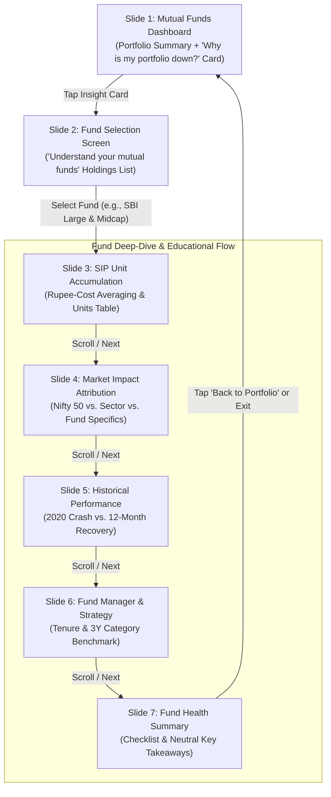
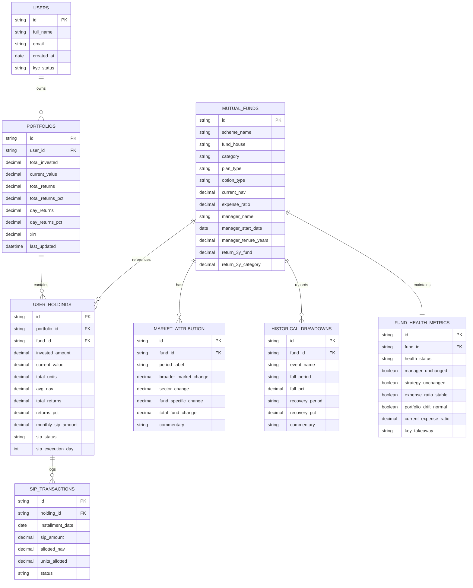
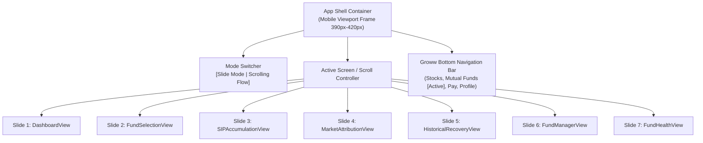

# System Architecture & Technical Specifications: Groww Portfolio Understanding MVP

---

## 1. Architecture Overview

The **Groww – Portfolio Understanding MVP** is built as a lightweight, mobile-first, high-performance web prototype. It is architected to operate in two presentation modes:
1. **Slide Mode (Modular Inspection):** Lets stakeholders inspect and review each screen (Slides 1 to 7) independently.
2. **Unified Long-Scrolling App Mode:** Integrates all screens into a seamless, interactive mobile experience with fluid transitions, fund selection, and animated data interactions.

---

## 2. End-to-End User Journey & Flow Architecture



### Flow Breakdown
1. **Discovery (Screen 1):** User lands on their regular Groww Mutual Funds Dashboard, sees red returns (`-₹500 (-8.33%)`), and discovers the contextual prompt card: *"Why is my portfolio down?"*.
2. **Categorization (Screen 2):** Clicking the card transitions to *"Understand your mutual funds"*, listing all active SIP funds with their individual invested amount, current value, and monthly SIP commitment.
3. **Primary Educational Hook (Screen 3):** User selects an underperforming fund (e.g., *SBI Large & Midcap Fund*). They are presented with the Rupee-Cost Averaging breakdown showing that lower NAV allowed them to accumulate **+9.6% more units** for the same ₹1,000 monthly SIP.
4. **Contextual Drivers (Screens 4–7):** Progressively explains broader market impact, historical rebound data, fund manager stability, and fund health checks.

---

## 3. Database Schema & Data Models

The data architecture is designed as a relational model that can be implemented using SQLite/PostgreSQL in production or an in-memory JSON store for the MVP prototype.



### Detailed Table Specifications

#### 1. `PORTFOLIOS` (Aggregate Portfolio Level)
| Column | Type | Sample Data | Description |
|---|---|---|---|
| `id` | UUID / String | `"port_01"` | Primary Key |
| `user_id` | UUID / String | `"usr_101"` | Foreign Key to User |
| `total_invested` | Decimal(12,2) | `6000.00` | Sum of all SIP contributions |
| `current_value` | Decimal(12,2) | `5500.00` | Current market value of units |
| `total_returns` | Decimal(12,2) | `-500.00` | Current value minus invested |
| `total_returns_pct` | Decimal(5,2) | `-8.33` | Percentage overall return |
| `day_returns` | Decimal(12,2) | `-120.00` | Today's net return |
| `day_returns_pct` | Decimal(5,2) | `-2.10` | Today's percentage movement |
| `xirr` | Decimal(5,2) | `-8.10` | Annualized return rate |

#### 2. `USER_HOLDINGS` (Fund Holding Level)
| Column | Type | Sample Data | Description |
|---|---|---|---|
| `id` | UUID / String | `"hld_sbi"` | Primary Key |
| `portfolio_id` | UUID / String | `"port_01"` | Foreign Key to Portfolio |
| `fund_id` | UUID / String | `"fund_sbi_large_mid"` | Foreign Key to Mutual Fund |
| `invested_amount` | Decimal(12,2) | `3000.00` | ₹3,000 invested over 3 months |
| `current_value` | Decimal(12,2) | `2750.00` | Current value |
| `total_units` | Decimal(10,4) | `32.8700` | Total units held |
| `total_returns` | Decimal(12,2) | `-250.00` | Unrealized loss |
| `returns_pct` | Decimal(5,2) | `-8.30` | Percentage loss |
| `monthly_sip_amount` | Decimal(10,2) | `1000.00` | Monthly SIP deduction |
| `sip_status` | Enum | `"ACTIVE"` | `ACTIVE`, `PAUSED`, `STOPPED` |

#### 3. `SIP_TRANSACTIONS` (Unit Accumulation Engine)
| Column | Type | Jan Row | Feb Row | Mar Row |
|---|---|---|---|---|
| `installment_date` | Date | `2026-01-05` | `2026-02-05` | `2026-03-05` |
| `sip_amount` | Decimal | `₹1,000.00` | `₹1,000.00` | `₹1,000.00` |
| `allotted_nav` | Decimal | `₹100.00` | `₹90.00` | `₹85.00` |
| `units_allotted` | Decimal | `10.0000` | `11.1111` | `11.7647` |
| `status` | Enum | `"SUCCESS"` | `"SUCCESS"` | `"SUCCESS"` |

---

## 4. Financial Calculations & Business Logic

### 4.1 SIP Unit Accumulation Formula
For each monthly SIP transaction $i$:
$$\text{Units}_i = \frac{\text{SIP Amount}_i}{\text{NAV}_i}$$

Total accumulated units:
$$\text{Total Units} = \sum_{i=1}^{n} \text{Units}_i = 10.00 + 11.11 + 11.76 = 32.87 \text{ units}$$

### 4.2 Rupee-Cost Averaging Comparison vs. Flat NAV
To demonstrate the value of continuing SIP during a downturn:
$$\text{Baseline Units (if NAV remained flat at ₹100)} = \frac{\sum \text{SIP Amount}}{\text{Initial NAV}} = \frac{₹3,000}{₹100} = 30.00 \text{ units}$$

$$\text{Additional Units Acquired} = 32.87 - 30.00 = +2.87 \text{ units}$$

$$\text{Percentage Advantage in Units} = \left(\frac{32.87 - 30.00}{30.00}\right) \times 100 \approx +9.57\% \approx \mathbf{+9.6\%}$$

### 4.3 Market Attribution Breakdown
$$\text{Total Fund Drop} = \text{Broader Market (Nifty 50)} + \text{Sector Impact} + \text{Fund Specific Factors}$$
$$-8.3\% = (-2.6\%) + (-4.1\%) + (-1.6\%)$$

---

## 5. Frontend Component Architecture



### Component Directory Structure
```text
h:\Antigravity\Groww MVP\
├── context.md                    # Core background, problem, and screen specs
├── architecture.md               # System flow, database schema, formulas & architecture
├── index.html                    # Single entry point with responsive mobile container
├── src/
│   ├── data/
│   │   ├── portfolioData.js      # Portfolio overview metrics & holdings list
│   │   ├── fundDetails.js        # SIP transactions, attribution, recovery & manager data
│   │   └── calculations.js       # Dynamic unit & percentage calculation helpers
│   ├── components/
│   │   ├── TopBar.js             # Groww dark top status bar and action icons
│   │   ├── BottomNav.js          # Groww sticky bottom navigation bar
│   │   ├── Slide1Dashboard.js    # Existing portfolio + "Why is my portfolio down?" card
│   │   ├── Slide2FundSelect.js   # "Understand your mutual funds" listing
│   │   ├── Slide3Accumulation.js # SIP unit accumulation table & RCA pill
│   │   ├── Slide4MarketImpact.js # Macro attribution breakdown
│   │   ├── Slide5Historical.js   # 2020 crash vs. 12M recovery chart
│   │   ├── Slide6Manager.js      # Fund manager stability & 3Y comparison
│   │   └── Slide7Health.js       # Health summary checklist & takeaway
│   └── styles/
│       └── groww-theme.css       # Groww design tokens (colors, typography, cards)
```

---

## 6. Regulatory & Compliance Safeguards

1. **Mandatory Unit Accumulation Disclaimer:**
   Every view demonstrating unit accumulation must render the standard disclaimer:  
   `"More units do not guarantee positive returns."`
2. **Neutral Educational Framing:**
   Copy avoids pushy language (e.g., *"Keep investing to get rich"*). Instead, it uses objective statements (e.g., *"When NAV is lower, the same SIP contribution purchases more units"*).
3. **Illustrative vs. Real Tagging:**
   All mock datasets are clearly tagged as illustrative scenarios when real backend brokerage feeds are simulated.

